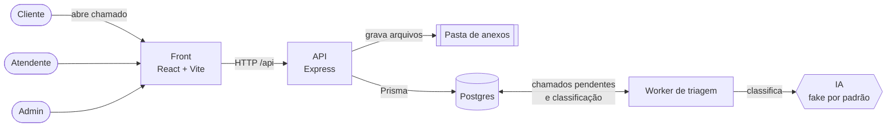
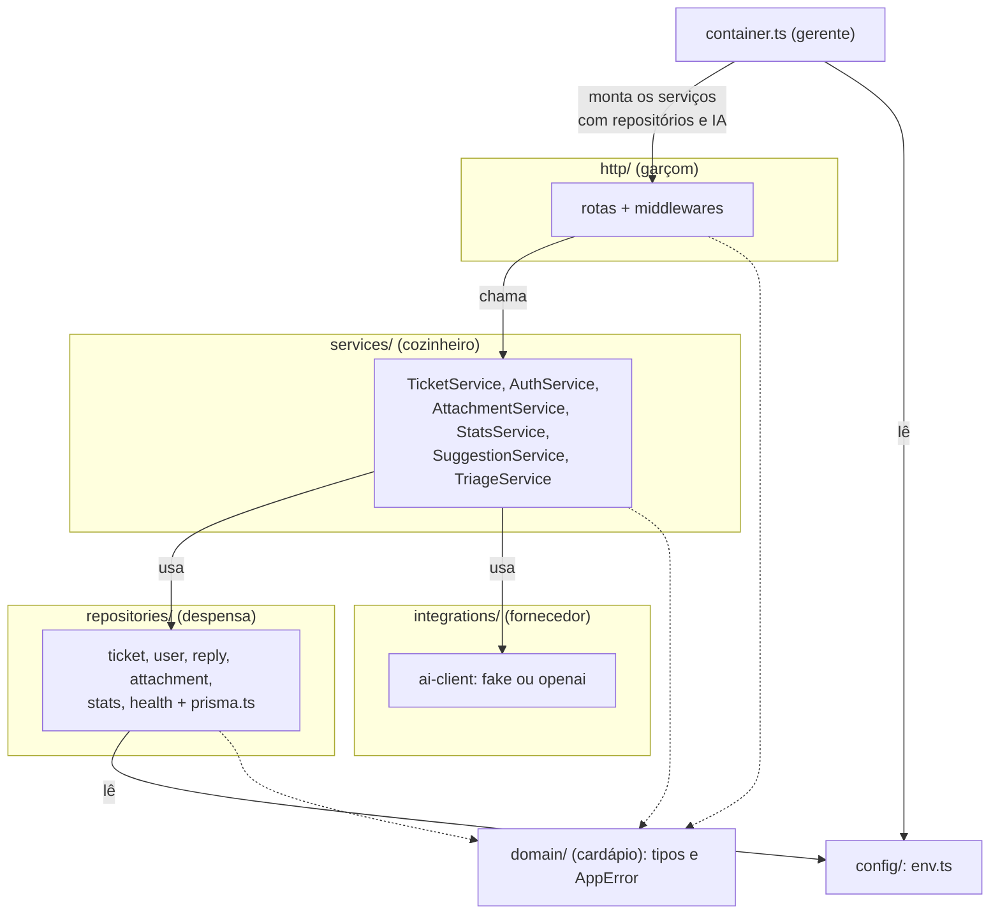
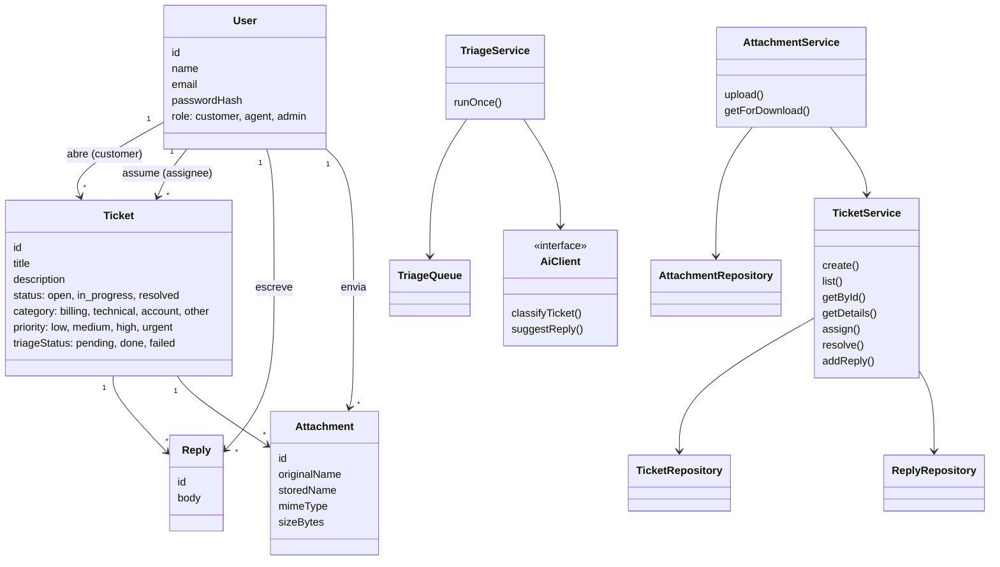
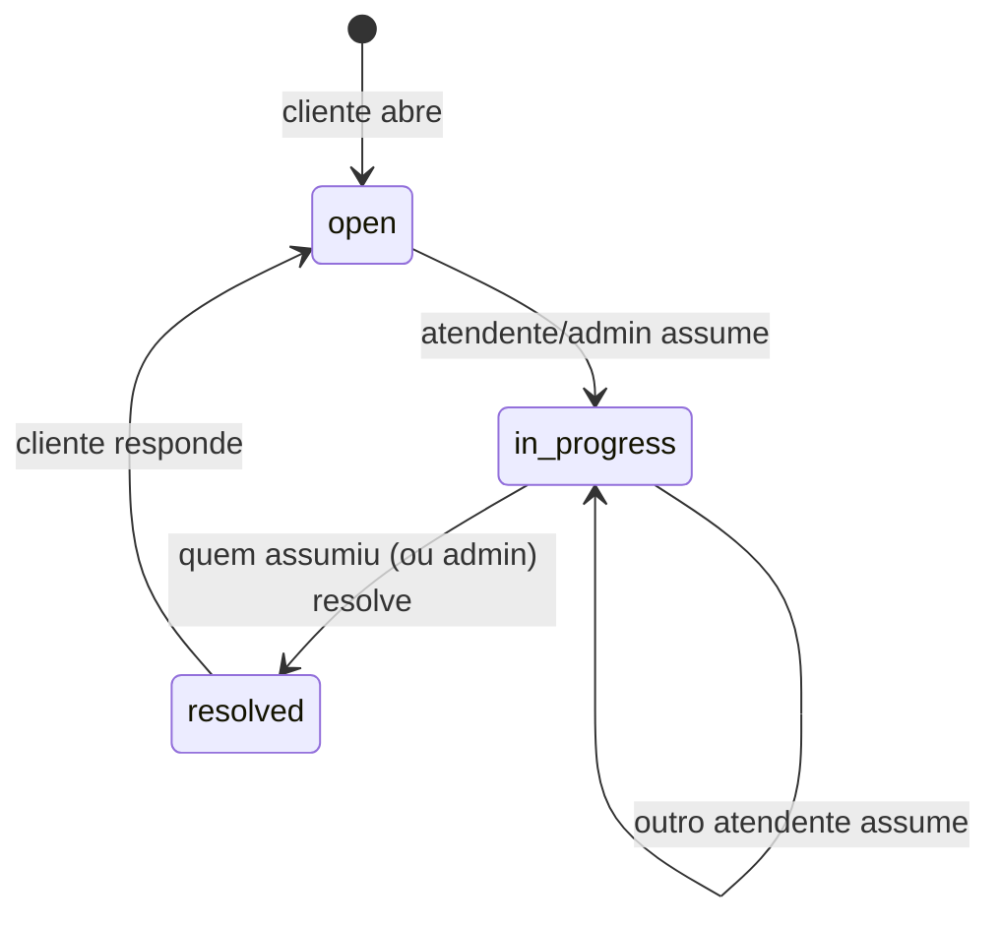
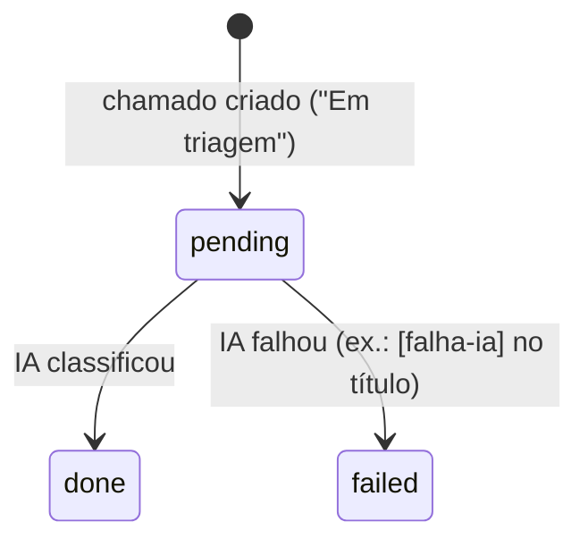
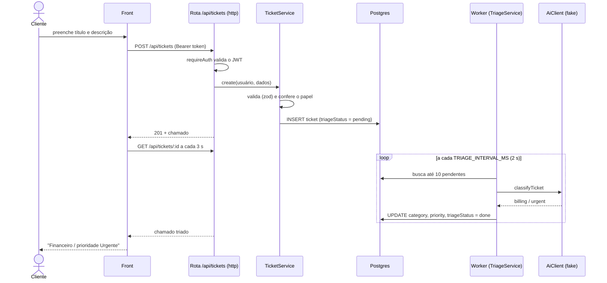

# Arquitetura do Balcão

<!-- TOC -->
- [Visão geral](#visão-geral)
- [As partes do repositório](#as-partes-do-repositório)
- [Camadas da API](#camadas-da-api)
- [Entidades e classes](#entidades-e-classes)
- [Ciclo de vida de um chamado](#ciclo-de-vida-de-um-chamado)
- [Fluxo de uma requisição](#fluxo-de-uma-requisição)
- [Autenticação](#autenticação)
- [IA: fake e OpenAI](#ia-fake-e-openai)
- [Front](#front)
<!-- TOC -->

Este documento explica como o Balcão funciona por dentro, para quem está chegando agora. Cada parte tem um diagrama e uma analogia do dia a dia.

## Visão geral

O Balcão é a central de chamados da empresa:

- **clientes** abrem chamados;
- um **worker** (processo separado) classifica cada chamado com IA: categoria e prioridade;
- **atendentes** assumem, respondem e resolvem;
- o **admin** acompanha as estatísticas.

> **Analogia: um pronto-socorro.** O cliente chega na recepção (front) e preenche a ficha (abre o chamado). A ficha vai para a fila; a enfermeira da triagem (worker) olha cada ficha e define a cor da pulseira (categoria e prioridade). Os médicos (atendentes) chamam pela pulseira, e a diretoria (admin) olha os números do dia.

## As partes do repositório

| Pasta | O que tem |
|---|---|
| `api/src/main.ts` | Entrada da API: monta os serviços e sobe o Express. |
| `api/src/config/` | Única leitura de variáveis de ambiente (`env.ts`). |
| `api/src/domain/` | Tipos de domínio (`Ticket`, `User`, `Reply`...) e `AppError`. |
| `api/src/http/` | App Express, rotas, middlewares de autenticação e tradução de erros. |
| `api/src/services/` | Regras de negócio (quem pode o quê, validações, transições de status). |
| `api/src/repositories/` | Acesso ao banco com Prisma. |
| `api/src/integrations/` | Cliente de IA: fake (palavras-chave) ou OpenAI. |
| `api/src/container.ts` | Composição: liga configuração, repositórios, integrações e serviços. |
| `api/src/jobs/triage-worker.ts` | Entrada do worker de triagem (processo separado da API). |
| `web/src/` | Front React: páginas, componentes, chamadas à API, `config/` e `types/`. |
| `blackbox/` | Suíte caixa-preta: testa a API de fora, pelo endereço em `API_URL`. |
| `kit-gates/` | Kit oficial que testa os gates plantando violações. |
| `harness/` | Exemplos de violação das regras próprias e violações extras. |
| `scripts/` | Subida, derrubada, gates, TOC, checagens de sistema e dependências. |

## Camadas da API

> **Analogia: um restaurante.** O **garçom** (`http/`) anota o pedido e entrega o prato, mas não cozinha nem entra na despensa. O **cozinheiro** (`services/`) segue as receitas (regras de negócio) e não fala com o cliente. A **despensa** (`repositories/`) guarda os ingredientes (o banco). O **fornecedor** (`integrations/`) entrega o que vem de fora (a IA). O **gerente** (`container.ts`) contrata cada um e apresenta uns aos outros no começo do dia. O **cardápio** (`domain/`) define os nomes que todos usam.

O que cada seta proibida significa, e qual gate barra:

| Proibido | Gate |
|---|---|
| `http/` importar `@prisma/client` ou `repositories/` | G4 |
| `services/` importar `express`, `multer` ou `http/` (inclusive só tipo) | G6 |
| `openai` fora de `integrations/` | G7 |
| `@prisma/client` fora de `repositories/` | G12 |
| `process.env` fora de `config/` | G5 |

Os serviços lançam `AppError(status, código, mensagem)` (de `domain/errors.ts`), e o `http/errors.ts` traduz para a resposta HTTP `{"error": "...", "message": "..."}`. Assim o cozinheiro avisa "acabou o peixe" sem saber como o garçom vai dar a notícia.

## Entidades e classes

## Ciclo de vida de um chamado

> **Analogia: a pulseira do pronto-socorro.** O chamado nasce "aberto" e "em triagem". A triagem coloca a pulseira (categoria e prioridade). Um atendente assume ("em andamento") e resolve ("resolvido"). Se o cliente responder depois de resolvido, o chamado volta para "aberto", com o mesmo atendente.

A triagem corre em paralelo, no worker:

## Fluxo de uma requisição

Exemplo: o cliente abre "Fatura em dobro, urgente".

## Autenticação

O login devolve um JWT válido por 8 horas, assinado com `JWT_SECRET`. O front guarda o token no `localStorage` e manda `Authorization: Bearer <token>` em cada chamada. O middleware `requireAuth` coloca o usuário na requisição; as rotas pegam com `currentUser(req)` e passam para os serviços, que decidem o que cada papel pode fazer.

> **Analogia: a pulseira de visitante.** Na portaria (login) você ganha uma pulseira que vale 8 horas. Cada porta (rota) olha a pulseira antes de abrir; quem decide se você pode entrar em cada sala é a regra da sala (serviço).

## IA: fake e OpenAI

`api/src/integrations/ai-client.ts` exporta `createAiClient({ mode, apiKey })`. Com `AI_MODE=fake` (padrão), a classificação usa palavras-chave e não precisa de chave; com `AI_MODE=openai`, usa a OpenAI (`OPENAI_API_KEY`). A API e o worker recebem o cliente pronto do `container.ts`.

## Front

- `web/src/config/env.ts` é o único lugar que lê `import.meta.env` (G5) e onde fica o endereço padrão da API (G11).
- `web/src/types/ticket.ts` tem os tipos do domínio usados no front; o front não importa nada de `api/` (G8), nem só tipos. Se a API mudar um literal, mude aqui também.
- `web/src/api/` concentra as chamadas HTTP (com `fetch`); as páginas ficam em `web/src/pages/`.
