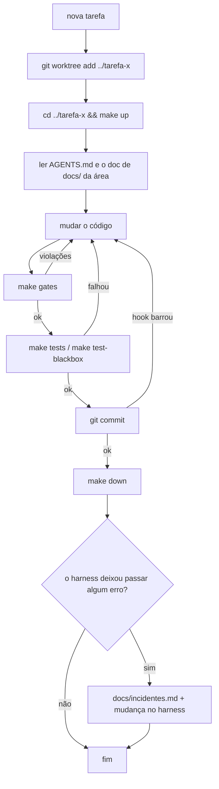

# Fluxo de trabalho com agentes

<!-- TOC -->
- [A ideia](#a-ideia)
- [O ciclo de uma tarefa](#o-ciclo-de-uma-tarefa)
- [Worktrees](#worktrees)
- [Commits](#commits)
- [Registro de incidentes](#registro-de-incidentes)
- [Sessões de agente](#sessões-de-agente)
<!-- TOC -->

## A ideia

Vários agentes trabalham ao mesmo tempo, cada um na sua worktree, e provam sozinhos que não quebraram nada. O harness é o que permite isso: um comando sobe o ambiente, os gates e o hook barram o desvio, e a documentação curta diz o resto.

> **Analogia: uma cozinha industrial com vários cozinheiros.** Cada cozinheiro tem a própria bancada (worktree com portas, banco e anexos próprios). As receitas ficam na parede (`AGENTS.md`). O fiscal de qualidade (gates) prova cada prato antes de sair, e a porta da cozinha (hook) não deixa passar prato frio. Quando um prato volta, a receita na parede é corrigida (registro de incidentes) para o próximo cozinheiro não repetir o erro.

## O ciclo de uma tarefa



## Worktrees

```bash
git worktree add ../tarefa-x        # cria a cópia (branch nova tarefa-x)
cd ../tarefa-x
make up                             # portas, banco, anexos e worker próprios
# ... trabalho ...
make down
cd - && git worktree remove ../tarefa-x
```

Cada worktree vira um projeto Docker Compose diferente (`balcao-<pasta>-<hash>`), então nada é compartilhado. O hook vale para todas as worktrees do clone (`core.hooksPath` fica na configuração do repositório).

## Commits

- Um commit por tarefa, com mensagem curta (português ou inglês).
- O hook roda tipos e lint; rode `make gates` completo antes.
- Nunca commite `.env` nem `.run/`; o `.gitignore` já cuida disso.
- Mudou comando, script, porta, variável ou regra? Atualize a documentação no mesmo commit e rode `make toc`.

## Registro de incidentes

Quando um agente erra e o harness não pegou, o erro vira uma entrada em [incidentes.md](incidentes.md) com:

1. o que aconteceu;
2. a mudança no harness que impede a repetição (gate, hook, script ou documento);
3. o hash do commit dessa mudança.

> O objetivo não é achar culpado: é fazer o próximo agente acertar de primeira.

## Sessões de agente

O agente lê o `AGENTS.md` (e o `CLAUDE.md`, no Claude Code) quando a sessão abre. Depois de mudar esses arquivos, abra uma sessão nova: a sessão aberta e os subagentes dela continuam com a versão antiga.
