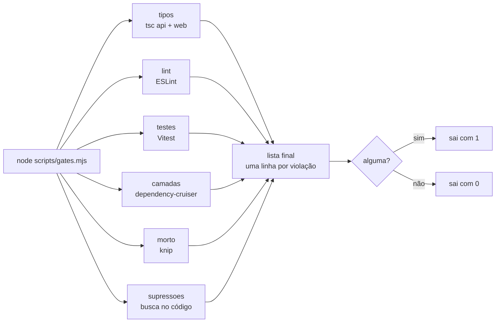

# Gates

<!-- TOC -->
- [O que são](#o-que-são)
- [As regras](#as-regras)
  - [Como cada ferramenta vira um ID](#como-cada-ferramenta-vira-um-id)
  - [Imports só de tipo (G6 e G8)](#imports-só-de-tipo-g6-e-g8)
  - [Exceções](#exceções)
- [Regras próprias](#regras-próprias)
  - [G11: nenhum endereço fixo fora de config/](#g11-nenhum-endereço-fixo-fora-de-config)
  - [G12: @prisma/client só em repositories/](#g12-prismaclient-só-em-repositories)
  - [G13: nenhum comentário de supressão](#g13-nenhum-comentário-de-supressão)
  - [Como aplicar os exemplos](#como-aplicar-os-exemplos)
- [Testando os gates](#testando-os-gates)
- [Hook de pre-commit](#hook-de-pre-commit)
- [Como corrigir cada violação](#como-corrigir-cada-violação)
<!-- TOC -->

## O que são

Gates são verificações automáticas que barram o código que fere as regras do projeto. Um único comando roda todas, sem parar na primeira falha, e termina com uma linha por violação:

```bash
make gates            # ou: bash scripts/gates.sh  /  node scripts/gates.mjs
```

```
Violações encontradas (2):
G4 api/src/http/routes/stats.ts  importa api/src/repositories/prisma.ts
G10 api/package.json  left-pad (dependência sem uso)
```

O formato é sempre `<ID> <arquivo>  <detalhe>`. O comando sai com código 1 se houver qualquer violação, 0 se tudo passar e 2 se ele próprio não conseguir rodar.

> **Analogia: o detector de metais do aeroporto.** Não importa quem você é nem a pressa que tem: se tiver metal, o portão apita e mostra onde. Os gates não confiam na memória de ninguém (nem do agente): conferem o código toda vez.



As seis verificações rodam em paralelo (cerca de 2 segundos). `node scripts/gates.mjs --list` lista as verificações, `--only=tipos,lint` roda só algumas e `--verbose` mostra a saída das ferramentas.

## As regras

| ID | Regra | Ferramenta | Configuração |
|---|---|---|---|
| G1 | Zero erro de tipo em `api/` e `web/` | `tsc --noEmit` | `api/tsconfig.json`, `web/tsconfig.json` |
| G2 | Lint sem erro nem warning em `api/` e `web/` (variável/import sem uso, `any` explícito e as regras recomendadas) | ESLint + typescript-eslint, `--max-warnings 0` | `eslint.config.mjs` |
| G3 | Testes unitários `api/src/**/*.test.ts` passam | Vitest | `api/vitest.config.mts` |
| G4 | `api/src/http/` não importa `@prisma/client` nem `api/src/repositories/` | dependency-cruiser | `.dependency-cruiser.cjs` |
| G5 | `process.env` só em `api/src/config/`; `import.meta.env` só em `web/src/config/` | ESLint (`no-restricted-properties`, `no-restricted-syntax`, `no-restricted-imports`) | `eslint.config.mjs` |
| G6 | `api/src/services/` não importa `express`, `multer` nem `api/src/http/`, inclusive só tipo | dependency-cruiser | `.dependency-cruiser.cjs` |
| G7 | `openai` só em `api/src/integrations/` | dependency-cruiser | `.dependency-cruiser.cjs` |
| G8 | `web/` não importa arquivos de `api/`, inclusive só tipo | dependency-cruiser | `.dependency-cruiser.cjs` |
| G9 | Nenhum import circular em `api/src/` e `web/src/` | dependency-cruiser | `.dependency-cruiser.cjs` |
| G10 | Nenhum arquivo, export (inclusive tipo) ou dependência sem uso em `api/` e `web/` | knip | `knip.json` |
| G11 | Regra própria: nenhum endereço fixo fora de `config/` | ESLint (`no-restricted-syntax`) | `eslint.config.mjs` |
| G12 | Regra própria: `@prisma/client` só em `api/src/repositories/` | dependency-cruiser | `.dependency-cruiser.cjs` |
| G13 | Regra própria: nenhum comentário de supressão em `api/src/` e `web/src/` | `scripts/gates.mjs` (busca) + `noInlineConfig` no ESLint | `scripts/gates.mjs` |

### Como cada ferramenta vira um ID

- **ESLint**: as mensagens das regras restritivas começam com o ID (`G5:`, `G11:`); qualquer outra mensagem é G2.
- **dependency-cruiser**: o nome de cada regra começa com o ID (`G4-http-nao-acessa-banco`).
- **tsc**, **Vitest** e **knip** dão sempre G1, G3 e G10.

### Imports só de tipo (G6 e G8)

O TypeScript apaga `import type` na compilação, e muitas ferramentas só olham o JavaScript resultante. O dependency-cruiser roda com `tsPreCompilationDeps: true`, que analisa o código antes dessa remoção: `import type { Request } from 'express'` num serviço e `export type { Ticket } from '../../../api/src/domain/ticket'` no front são barrados.

### Exceções

A única exceção é a que define a regra: `api/src/config/` e `web/src/config/` podem ler variáveis de ambiente (G5) e definir endereços padrão (G11). Nenhum arquivo de `api/src/` ou `web/src/` fica fora de qualquer verificação, e não há comentário de supressão: o ESLint roda com `noInlineConfig` (comentários `eslint-disable` não têm efeito) e a G13 barra esses comentários e os `@ts-ignore`, `@ts-expect-error` e `@ts-nocheck`.

## Regras próprias

### G11: nenhum endereço fixo fora de config/

- **Motivação.** O Balcão "achava que era a única cópia no mundo": CORS fixo em `http://localhost:5173`, front chamando `http://localhost:4000` em três lugares, anexos em `/tmp/balcao/uploads`. Com duas worktrees, a segunda cópia falava com a API da primeira e gravava anexos na mesma pasta. Endereços agora vêm da configuração de cada cópia.
- **O que barra.** Strings e template strings com `localhost`, `127.0.0.1`, `0.0.0.0` ou `/tmp/` em `api/src/` e `web/src/`, fora de `config/`.
- **Exemplos versionados.** `harness/violacoes-proprias/G11-a-url-fixa-na-api`, `G11-b-pasta-tmp-fixa` e `G11-c-ip-fixo-no-front`.

### G12: @prisma/client só em repositories/

- **Motivação.** O worker de triagem criava o próprio `PrismaClient`, lendo `process.env.DATABASE_URL` direto e ignorando a configuração central. A G4 só protege `http/`; qualquer outra pasta (jobs, services, integrations) podia voltar a falar direto com o banco.
- **O que barra.** Qualquer import de `@prisma/client` (inclusive só tipo) em `api/src/` fora de `api/src/repositories/`.
- **Exemplo versionado.** `harness/violacoes-proprias/G12-prisma-fora-de-repositories`.

### G13: nenhum comentário de supressão

- **Motivação.** O jeito mais rápido de "passar" num gate é desligá-lo no próprio arquivo, e o `CLAUDE.md` antigo até mandava usar `any` "para não travar a entrega". O TASK.md proíbe supressões; esta regra transforma a proibição em verificação.
- **O que barra.** `eslint-disable`, `eslint-enable`, comentários de configuração do ESLint, `@ts-ignore`, `@ts-expect-error` e `@ts-nocheck` em `api/src/` e `web/src/`.
- **Exemplos versionados.** `harness/violacoes-proprias/G13-a-ts-ignore` e `G13-b-eslint-disable-no-front`.

### Como aplicar os exemplos

Os exemplos estão no mesmo formato do `kit-gates/` (um `manifesto` e arquivos `.modelo`). Com `git status` limpo:

```bash
make gates-proprias
# ou: bash scripts/verificar-violacoes.sh harness/violacoes-proprias [G11|G12|G13]
```

O script planta cada exemplo, roda os gates, confere a linha com o ID e o arquivo e desfaz tudo. Para aplicar um exemplo à mão:

```bash
cp harness/violacoes-proprias/G11-a-url-fixa-na-api/arquivos/api/src/services/link-painel.ts.modelo \
   api/src/services/link-painel.ts
make gates          # falha com: G11 api/src/services/link-painel.ts ...
rm api/src/services/link-painel.ts
```

## Testando os gates

| Comando | O que faz |
|---|---|
| `make gates-kit` | Kit oficial (`kit-gates/`): planta 19 violações de G1 a G10. |
| `make gates-extras` | 29 violações extras de G1 a G10 escritas de outras formas: `process['env']`, desestruturação, `globalThis.process.env`, `import { env } from 'node:process'`, `import.meta['env']`, re-export de repositório, `import()` dinâmico, tipo do Prisma na rota, `import type` de multer, ciclo de três arquivos, ciclo só de tipos, dependência sem uso no front etc. |
| `make gates-proprias` | Exemplos das regras próprias G11 a G13. |

Os três precisam de `git status` limpo e saem com 0 só se todas as violações forem barradas. Rode os três sempre que mexer em `eslint.config.mjs`, `.dependency-cruiser.cjs`, `knip.json` ou `scripts/gates.mjs`: uma opção errada desliga uma regra sem nenhum aviso (aconteceu: veja [incidentes](incidentes.md)).

## Hook de pre-commit

`.githooks/pre-commit` roda `node scripts/gates.mjs --only=tipos,lint,supressoes` (G1, G2, G5, G11 e G13) e bloqueia o commit se algo falhar. Ele é ativado por `make up` e por `make install` (`git config core.hooksPath .githooks`); num clone novo, basta a subida. Os gates completos (testes, camadas e código morto) ficam no `make gates`, para o commit continuar rápido.

> **Analogia: o cinto de segurança.** O carro não anda sem ele. Não é o airbag (os gates completos), mas pega os erros mais comuns antes de sair da garagem.

## Como corrigir cada violação

| ID | Como corrigir |
|---|---|
| G1 | Ajuste o tipo, não o silencie. |
| G2 | Remova o que não é usado; troque `any` por um tipo real ou `unknown` com verificação. |
| G3 | Corrija o código ou o teste; `cd api && ./node_modules/.bin/vitest run <arquivo>` roda um só. |
| G4 | Crie ou use um método de serviço; o serviço usa o repositório. Ligue tudo em `api/src/container.ts`. |
| G5 | Adicione a variável em `api/src/config/env.ts` (com padrão) ou `web/src/config/env.ts` e importe de lá. |
| G6 | Lance `AppError` (`api/src/domain/errors.ts`) e receba dados simples (ex.: `UploadedFile`), não `Request`. |
| G7 | Coloque a chamada em `api/src/integrations/ai-client.ts` e exponha uma função. |
| G8 | Declare o tipo em `web/src/types/`. |
| G9 | Mova o código compartilhado para um módulo de baixo nível (ex.: `domain/`). |
| G10 | Apague o arquivo, o `export` ou a dependência sem uso. |
| G11 | Leve o endereço para `config/` com padrão e leia de lá. |
| G12 | Use um repositório (`api/src/repositories/`). |
| G13 | Remova o comentário e corrija a causa. |
