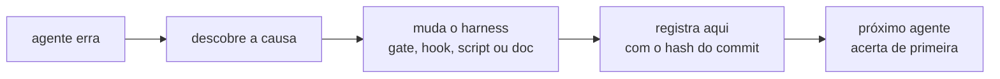

# Registro de incidentes

<!-- TOC -->
- [Incidentes](#incidentes)
  - [I1: exclude de node_modules desligou G6, G7 e G12 em silêncio](#i1-exclude-de-node_modules-desligou-g6-g7-e-g12-em-silêncio)
  - [I2: pkill -f matou o shell do próprio agente](#i2-pkill--f-matou-o-shell-do-próprio-agente)
  - [I3: container do front quebrou ao rodar com o UID do host](#i3-container-do-front-quebrou-ao-rodar-com-o-uid-do-host)
  - [I4: npm uninstall reescreveu o lockfile inteiro](#i4-npm-uninstall-reescreveu-o-lockfile-inteiro)
- [Como registrar um incidente novo](#como-registrar-um-incidente-novo)
<!-- TOC -->

Erros reais de agentes durante a construção do harness. Cada entrada diz o que aconteceu, a mudança no harness que impede a repetição e o hash do commit dessa mudança (`git show --stat <hash>`).

> **Por que registrar?** A cada erro do agente, o harness muda para que o próximo agente não repita o erro. O registro não serve para achar culpado: é a memória do time.

## Incidentes

### I1: exclude de node_modules desligou G6, G7 e G12 em silêncio

- **Agente:** Claude Code (Claude Opus), montando os gates.
- **O que aconteceu:** na primeira versão do `.dependency-cruiser.cjs`, o agente colocou `exclude: { path: 'node_modules' }` para "deixar a análise mais rápida". Isso tirou os pacotes externos do grafo: as regras que olham `express`, `multer`, `openai` e `@prisma/client` pararam de disparar, sem erro nenhum. O serviço com `import type { Request } from 'express'`, a rota que importava `openai` e o worker com `PrismaClient` próprio passavam. Só a comparação com o `grep` do diagnóstico mostrou que faltavam violações.
- **Mudança no harness:** `exclude` removido (fica só `doNotFollow`), com um comentário no próprio `.dependency-cruiser.cjs` proibindo a volta. Foram criadas as violações extras em `harness/violacoes-extras/` (29 formas diferentes de G1 a G10, incluindo imports só de tipo de pacotes externos) e o alvo `make gates-extras`. O `CLAUDE.md` e o `docs/gates.md` mandam rodar `make gates-kit`, `make gates-extras` e `make gates-proprias` depois de mexer em configuração de gate.
- **Commit:** `d942157` (configuração corrigida e comentada)
- **Commit:** `b69be34` (violações extras e `scripts/verificar-violacoes.sh`)

### I2: pkill -f matou o shell do próprio agente

- **Agente:** Claude Code (Claude Opus), reiniciando a API depois da refatoração.
- **O que aconteceu:** para reiniciar a API e o worker, o agente rodou `pkill -f "tsx --env-file=.env src/main.ts"`. O padrão casou com a linha de comando do próprio shell que executava o `pkill`, e o comando morreu no meio (código 144), sem subir a API de novo. É a mesma família do conselho do `CLAUDE.md` antigo ("se der EADDRINUSE, use `kill -9` no processo que está na porta"): com duas cópias no ar, matar pela porta ou por padrão derruba o processo errado.
- **Mudança no harness:** a API e o worker passaram a rodar em containers de um projeto Compose por cópia, e `make down` (`scripts/down.sh`) derruba só o projeto da cópia. O `AGENTS.md` ganhou a regra "nunca mate processo por porta ou por padrão (`kill -9`, `pkill -f`); use `make down`", e a subida escolhe outra porta quando a padrão está ocupada, em vez de pedir para matar quem está nela.
- **Commit:** `5b4d450` (`scripts/down.sh` por projeto e portas livres)
- **Commit:** `0f897f0` (regra no `AGENTS.md`)

### I3: container do front quebrou ao rodar com o UID do host

- **Agente:** Claude Code (Claude Opus), criando as imagens Docker.
- **O que aconteceu:** para os anexos em `.run/uploads` pertencerem ao usuário (e não ao root), o agente fez os containers rodarem com o UID/GID do host. A imagem do front foi construída como root, e o Vite precisa gravar um arquivo temporário ao lado do `vite.config.ts`: o container entrou em loop de reinício com `EACCES`. A primeira subida esperou 3 minutos e só falhou no fim, porque o script só olhava a API.
- **Mudança no harness:** `web/Dockerfile` deixa `/app` e `node_modules/.vite` graváveis. O `scripts/up.sh` espera a API **e** o front responderem, confere que o worker está rodando e, se algo não subir, mostra `docker compose ps` e os últimos logs antes de sair com erro.
- **Commit:** `5b4d450`

### I4: npm uninstall reescreveu o lockfile inteiro

- **Agente:** Claude Code (Claude Opus), removendo a dependência sem uso `lodash` (G10).
- **O que aconteceu:** `npm uninstall lodash` com o npm 11 reescreveu metadados de dezenas de entradas do `api/package-lock.json` (`"peer": true`), gerando um diff grande e sem relação com a tarefa. O agente desfez e removeu só as entradas do `lodash`. O mesmo acontece com `npm install` em qualquer pasta.
- **Mudança no harness:** toda instalação passa por `scripts/install-deps.sh`, que usa `npm ci` (respeita o lockfile como está) e só reinstala uma pasta quando o lockfile dela muda. O `AGENTS.md` diz para instalar com `make install` e o `CLAUDE.md` descreve como atualizar dependências só quando pedido, conferindo o diff do lockfile.
- **Commit:** `5b4d450` (`scripts/install-deps.sh` com `npm ci`)
- **Commit:** `0f897f0` (regras no `AGENTS.md` e no `CLAUDE.md`)

## Como registrar um incidente novo

1. Descreva o que o agente fez e por que o harness não pegou.
2. Mude o harness (gate, hook, script ou documento) num commit próprio.
3. Adicione uma entrada `### I<n>: <resumo>` aqui com **Agente**, **O que aconteceu**, **Mudança no harness** e **Commit:** `<hash>`.
4. Rode `bash scripts/check-docs.sh`: ele confere que cada hash existe e mexe no harness.
