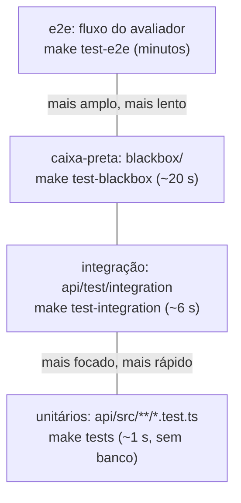
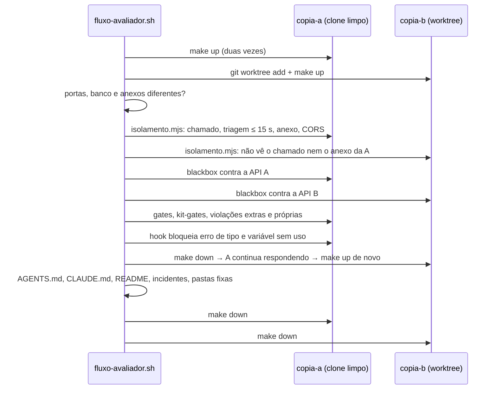

# Testes

<!-- TOC -->
- [A pirâmide](#a-pirâmide)
- [Unitários](#unitários)
- [Integração](#integração)
- [Caixa-preta](#caixa-preta)
- [e2e: fluxo do avaliador](#e2e-fluxo-do-avaliador)
<!-- TOC -->

## A pirâmide

> **Analogia: a inspeção de um carro.** Os testes unitários conferem cada peça na bancada (rápido, sem o carro montado). Os de integração conferem as peças montadas com o motor ligado (banco de verdade). A caixa-preta é o test drive: alguém de fora dirige sem abrir o capô. O e2e é a vistoria completa do Detran, com dois carros na pista ao mesmo tempo.



| Tipo | Onde | Comando | Precisa |
|---|---|---|---|
| Unitários | `api/src/**/*.test.ts`, ao lado do código, e `tests/harness/` (scripts do harness) | `make tests` | Nada (sem banco) |
| Integração | `api/test/integration/` | `make test-integration` | `make up` |
| Caixa-preta | `blackbox/tests/` | `make test-blackbox` | `make up` |
| e2e (fluxo do avaliador) | `tests/e2e/` | `make test-e2e` | Docker livre para duas cópias extras |

## Unitários

Rodam com Vitest e sem banco: os serviços recebem repositórios falsos no construtor. São a G3 dos gates. Todo serviço em `api/src/services/` tem um `*.test.ts` ao lado. O `make tests` também roda `tests/harness/` (com `node --test`), que testa o gerador de sumário.

```bash
make tests
cd api && ./node_modules/.bin/vitest run src/services/ticket-service.test.ts   # um arquivo
```

## Integração

`make test-integration` cria (se preciso) e migra o banco `balcao_test` **no Postgres desta cópia** e roda `api/test/integration/`. Nunca usa o banco `balcao`.

| Arquivo | Cobre |
|---|---|
| `user-repository.test.ts`, `ticket-repository.test.ts` | Repositórios Prisma no banco real, incluindo a fila de triagem do worker. |
| `seed.test.ts` | A seed roda duas vezes no mesmo banco sem falhar nem duplicar (subida repetida). |
| `fluxo-avaliador.test.ts` | Fluxos do avaliador contra a API desta cópia: health, as três contas da seed, "Fatura em dobro, urgente" triado como Financeiro / Urgente em até 15 s, `[falha-ia]`, anexo `.txt` na pasta de anexos da cópia, isolamento entre clientes, assumir, resolver e estatísticas do admin. |

## Caixa-preta

A suíte `blackbox/` é o contrato da API: testa rotas, corpos, status e códigos de erro de fora, pelo endereço em `API_URL`. Ela não pode ser editada. `make test-blackbox` usa a API desta cópia; para outra: `API_URL=http://localhost:4001 make test-blackbox`.

## e2e: fluxo do avaliador

`make test-e2e` (`tests/e2e/fluxo-avaliador.sh`) reproduz o fluxo do avaliador do TASK.md numa pasta temporária, com o último commit:



Para usar a suíte caixa-preta do repositório base, como o avaliador:

```bash
BASE=https://github.com/devfullcycle/mba-ia-desafio-harness-legado make test-e2e
```

O `tests/e2e/isolamento.mjs` também roda sozinho, contra duas cópias já no ar:

```bash
node tests/e2e/isolamento.mjs <API A> <anexos A> <API B> <anexos B> [front A] [front B]
```
